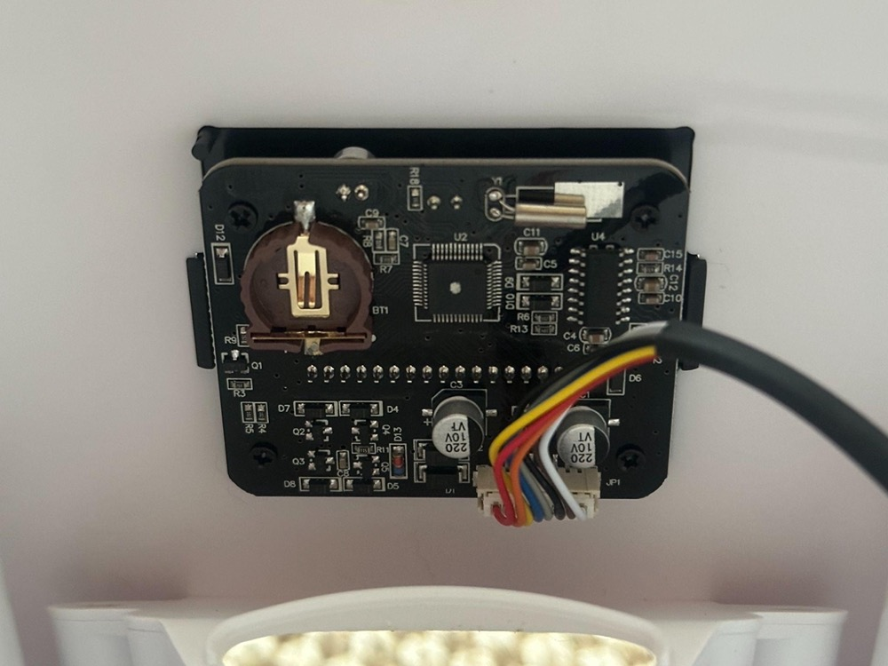
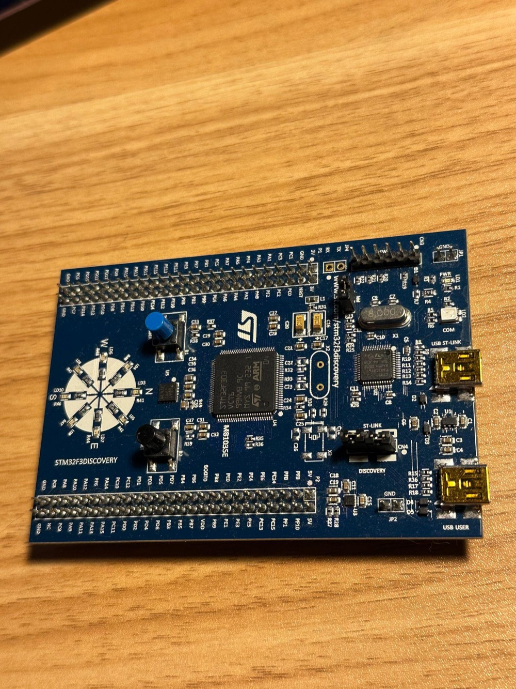
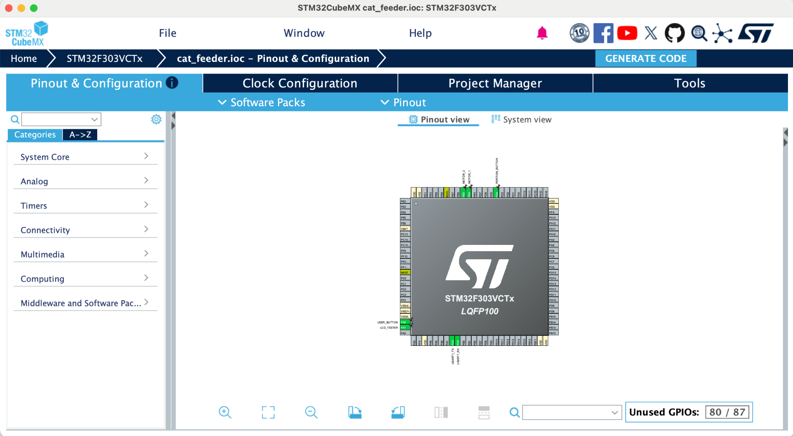
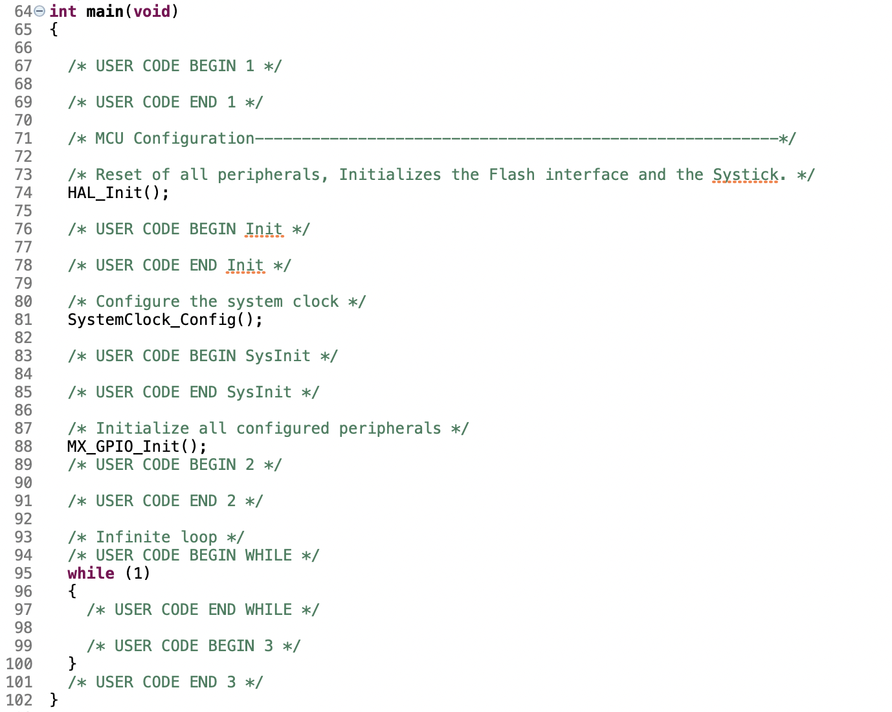
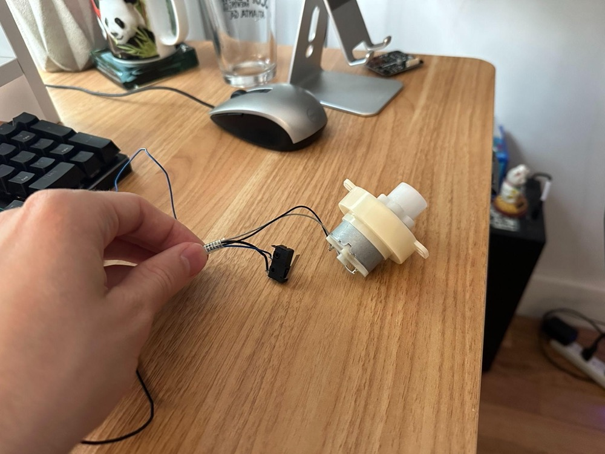
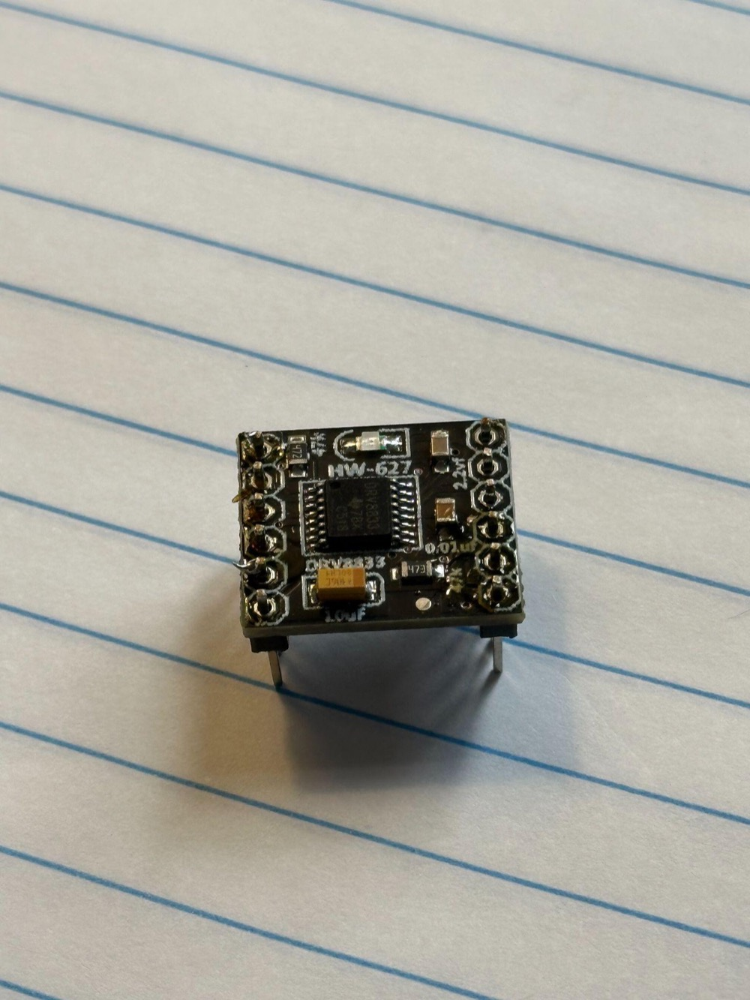
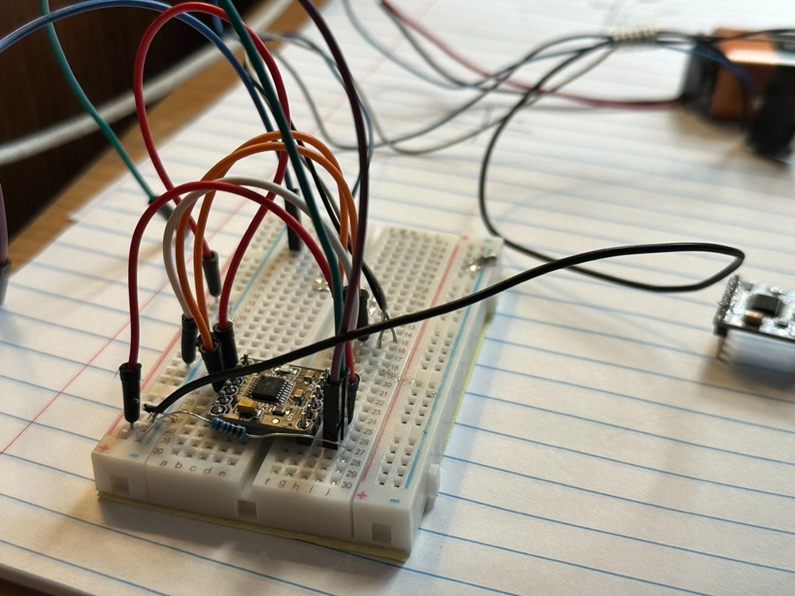

A couple years ago I bought an automatic dry food cat feeder, which instantly changed my life. My cat, Sabrina, loves it - she still pesters me for her wet food, but the cat feeder takes care of the dry food cravings.

The feeder has been great, but I've been noticing the clock drifting, sometimes by hours, every time I go to change a setting on it. Suddenly, I had a bright idea. I've been wanting to start working on embedded programming for a while, so why not take it apart and fix the clock issue! How hard can it be? So, this is my journey. Sit back and enjoy the ride.

---

I don't know what I expected of this project. I think I expected there to be some chip on the feeder that I could connect to and program a quick internet sync module on or something like that. However, after taking the feeder apart, I realized that the brain was some random Chinese board that had the chip model number lasered off.



Researching the board number didn't help either - no results found for DDV19NA.

It seemed evident that I would have to either completely reverse engineer the chip, or build my own brain for the feeder. I decided the quickest way forward was to build my own.

I had already bought an STM32 Discovery board a while ago, so I started using it for this project. This was recommended for beginners as you can toy around with it - not sure if I'll stick with it for the finished product but I can experiment at least.



When connecting it to my computer, I had no idea how it worked. I learned about two programs that would come in handy - STM32CubeMX and STM32CubeIDE. Opening these up felt like a whole new world. It was extremely unfamiliar and outside of my wheelhouse. The biggest advice I would give if you find yourself in this situation, is just to take a deep breath, and continue one step at a time. You will slowly learn more and build your base.

After first opening STM32CubeMX, you create a project and choose your specific board. I chose my Discovery Board (STM32F303), and it opened up the main page - a pin configuration layout with a sidebar for different modules on the board. The tabs above are Pinout & Configuration, Clock Configuration, Project Manager, and Tools.



Basically how CubeMX works is you configure specific pins and features on the board before you use them. You can set them to Pull Up (default to 1) or Pull Down (default to 0) depending on how you want to drive current through them. And you can configure timing paths - there are multiple crystals and potentially external timing modules you can add. You configure the right ones, set up the GPIO pins for input and output, and whatever else you want. Then you hit "Generate Code" and it generates a really handy project for you.

Next you open this project up in the IDE, plug in your board, and create a run configuration for your specific board. In `main.c`, you can see the code has specified where your User Code should be. This is so that if you regenerate the project, your user code is untouched. You can program different parts. In User Code 3, you see `while(1)`. This is your main while loop. Once you start the program, it configures everything it needs to configure, then runs the while loop forever. In this while loop, you do stuff like sensor checking, processing data, and more.



## Getting My Hands Dirty

First things first, I took apart the cat feeder completely including the motor. The motor had two wires coming off of it as well as another piece. This piece was a button used to count the number of motor rotations for portion control.

I bought some motor controllers from Amazon. When they arrived, they came with the board and pins separate. As this is my first electronics project, I didn't realize you had to solder them on. I thought you could just stand it up on the pins and it would work. So, I drafted it out on the breadboard. Nothing happened. I figured the motor controller must be broken, so I tried a different one. Still didn't work. I finally realized that you're supposed to solder the board on, so I ordered a Hakko soldering iron.



My first soldering job.



My coworker gave me an old RadioShack soldering iron, but I couldn't really get it to work. The tin wasn't dripping down, it was staying at the tip of the iron. Another coworker said that if I wanted to learn to solder, he'd highly recommend to learn on a Hakko, and said it makes it a lot easier. I trusted him, so I bit the bullet and bought the more expensive Hakko as well as a soldering station with a stand, steel wool and a sponge.

After a couple of tries, this worked perfectly. The solder dripped down and sealed the connection joints. When I plugged everything in, the LED turned on. I followed [this tutorial](https://www.pschatzmann.ch/home/2020/08/25/taming-the-hw-627-motor-controller/) for wiring up the motor controller. It worked flawlessly. Then, I connected the IN1 and IN2 to the GPIO pins and started working on the code inside STM32CubeIDE.

I first set it to just run continuously. However, I noticed that whenever the device was re-flashed, the motor started running. I wanted to fix this, so I put a resistor to ground on IN2 that would drive it down. There was still a little bit of turning but it was acceptable at this point, so I decided to move on to the next step - using that little button to trigger portion sizes.



I programmed some portion logic in so that the motor would start, and I could press the button 3 times before it would stop. Eventually, this will be positioned like before, touching the motor so that the motor triggers the stop itself, and the software decides portion control.

Here's the code for it:


```c
/* Feed on schedule if enabled */
if (feeding_enabled)
{
    HAL_RTC_GetTime(&hrtc, &sTime, RTC_FORMAT_BIN);
    HAL_RTC_GetDate(&hrtc, &sDate, RTC_FORMAT_BIN);

    // todo replace with specific times of day
    if (sTime.Seconds % 10 == 0)
    {
        uint8_t portions = 0;
        uint8_t max_portions = 3;

        while (feeding_enabled && portions < max_portions) {
            /* Start motor */
            HAL_GPIO_WritePin(GPIOB, MOTOR_1_Pin, GPIO_PIN_SET);
            HAL_GPIO_WritePin(GPIOB, MOTOR_2_Pin, GPIO_PIN_RESET);

            /* Wait until button is pressed to stop */
            while (HAL_GPIO_ReadPin(PORTION_BUTTON_GPIO_Port, PORTION_BUTTON_Pin) == GPIO_PIN_SET) {
                if (HAL_GPIO_ReadPin(USER_BUTTON_GPIO_Port, USER_BUTTON_Pin) == GPIO_PIN_SET) {
                    feeding_enabled = 0;
                    printf("Feeding disabled via user button\r\n");
                    break;
                }
            }

            portions++;
            printf("Portion pressed\n");

            /* Debounce */
            HAL_Delay(50);

            /* Stop motor */
            HAL_GPIO_WritePin(GPIOB, MOTOR_1_Pin, GPIO_PIN_RESET);
            HAL_GPIO_WritePin(GPIOB, MOTOR_2_Pin, GPIO_PIN_RESET);
            HAL_Delay(1000);
        }
        feeding_enabled = 0;
    }
}
```

And finally, [a demo](https://drive.google.com/file/d/1d_r2_m8EBlbz3Z4DusqMQ0_ZI2RkvTXG/view?usp=sharing) of the current state.

## Lessons Learned

Some lessons learned is that you have no idea what pieces you have available until you start. There are so many different electronics pieces, and it will all be gibberish until you start. Then you slowly learn. Once you have a foothold, you can expand faster, but just focus on getting that foothold. That applies to anything you learn. Now, I know how to change the pin configuration, add buttons, read input, and drive a motor. I can use those tools to ideate on what I can do next and what I still need to learn.

Claude helped a lot. It would tell me exactly where to navigate within CubeMX.
