QEMU is something I've wanted to learn for a while. I used it (very slightly) in college, but after that, I haven't really had a use for it. But as it's such a popular tool, I wanted to learn more about how it worked. For those that don't know, QEMU is a piece of software that emulates different machines - kind of like a GBA emulator. The difference is that QEMU can emulate a full modern computer. It maps fake network cards, graphics cards, storage, and makes the resulting virtual hardware device practically undetectible by the software it runs. This means that you can run hardware specific software on your machine. It's similar to a virtual machine but can be much faster. It differs from a container in that it emulates the entire computer, where containers often just run isolated processes.

For my project, I decided to try something fun and nostalgic - running Windows 95 on my Macbook Pro. I followed [this tutorial](https://wiki.qemu.org/Documentation/GuestOperatingSystems/Windows95) for the most part.

To launch I had to use this command:

```
qemu-system-i386 -netdev user,id=mynet0 -device ne2k_isa,netdev=mynet0 -hda win95.qcow2 -drive file=disk01.img,format=raw,if=floppy -cdrom CDs/Win95_OSR25.iso -audio coreaudio,model=sb16 -m 32 -cpu pentium -vga cirrus -rtc base=localtime -boot a -display cocoa,zoom-to-fit=on
```

This launches an i386 system, establishes the network to route locally, points to the floppy disk and Windows installation CD, links the audio to MacBookPro CoreAudio, gives it 32MB of memory, specifies the CPU and graphics card, sets the time, and instructs it to boot from A:/ (the installation media).

I then launched the Windows Installer using fdisk and ran it through to completion. I booted it up again, this time with "-boot c" to boot from the c: drive, but unfortunately I ran into a Windows system error:

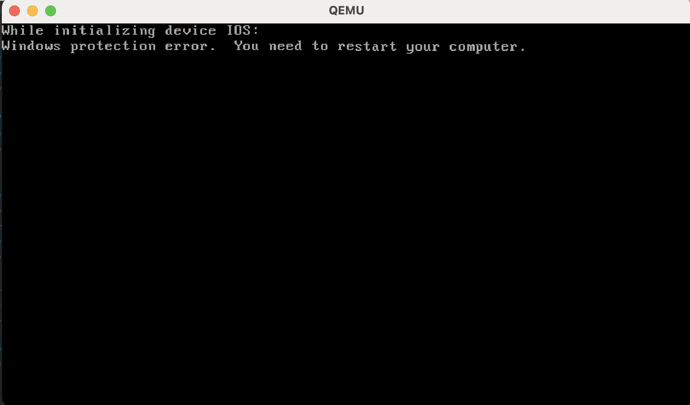

I tried many different methods to debug this, and finally found a [link online](https://github.com/utmapp/UTM/discussions/5191) where someone recommended running FixCPU. I put the executable into an ISO and fed it into QEMU. I booted from the "d:" drive and it went ahead and ran the fix. I re-booted into Windows and was able to successfully launch Windows 95! (Note - when you run Windows the first few times, make sure to leave the installation CD in. The setup continues to use it for packages even after Windows is installed)

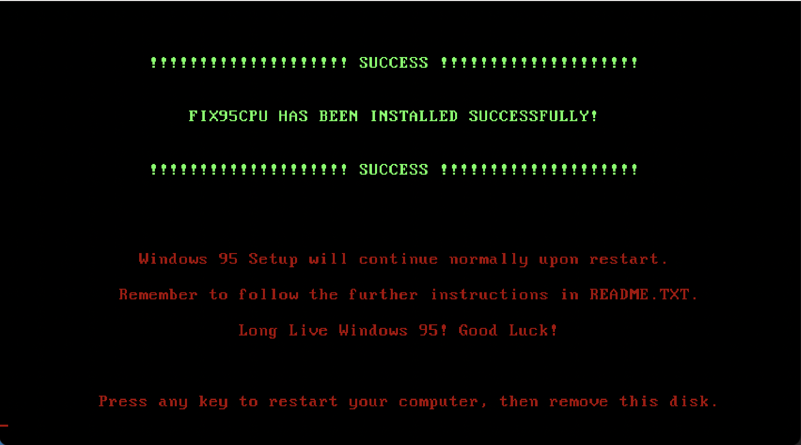

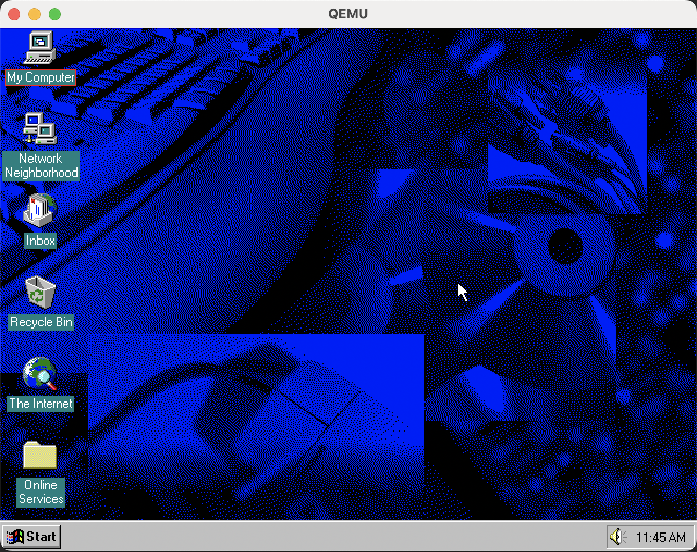

From here I tried to get networking to work.

I followed the original tutorial to install my network drive but it seemed that I still needed to install the TCP/IP protocol.

Control Panel -> Network
Add -> Protocol -> Microsoft -> TCP/IP

After a restart, the networking stopped giving errors, but I was surprised to find that bascially no websites work.

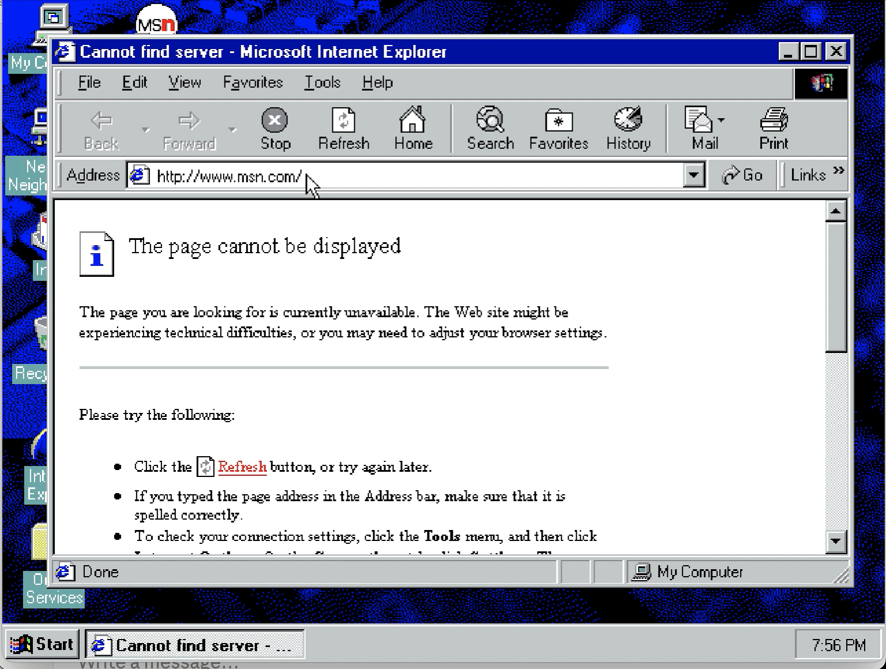

Apparently they are all using TLS which the old protocols don't support. It also doesn't support Javascript so I was out of luck there.

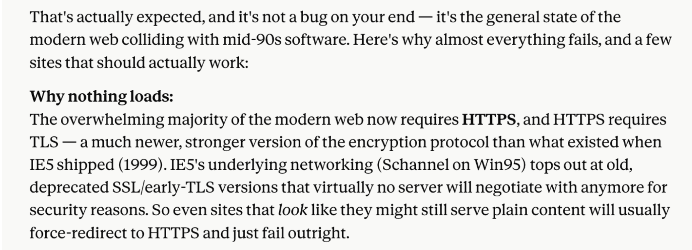

I was able to find like one site [www.textfiles.com](http://www.textfiles.com) that uses pure HTTP with no TLS:

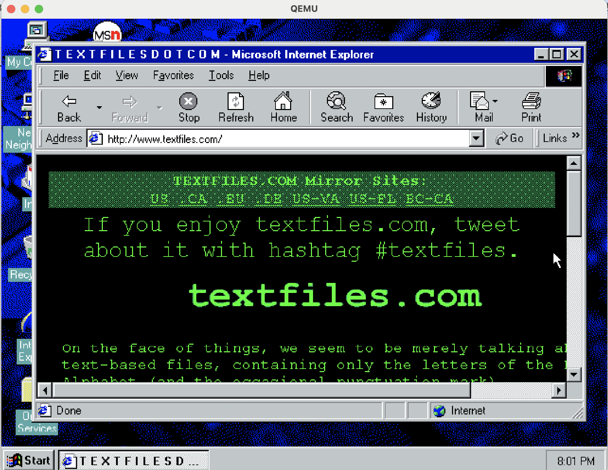

After that, I decided it was time to install some games! I rebooted with the installer disk selected, went to the Control Panel and clicked "Add Programs", and added Games. Booted up Minesweeper:

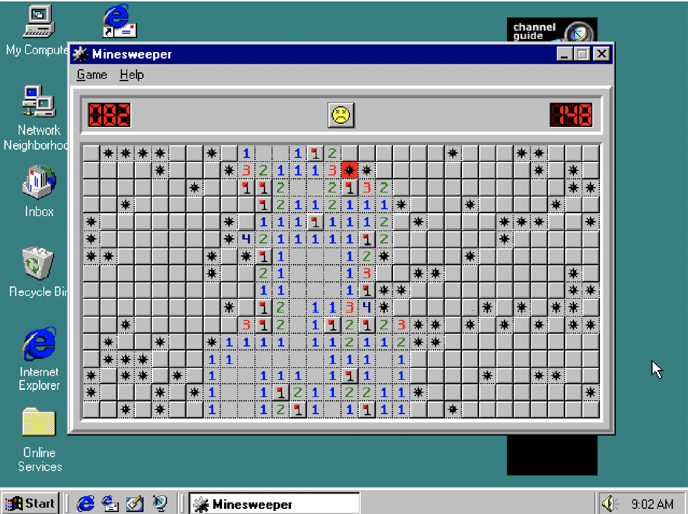

And solitaire:

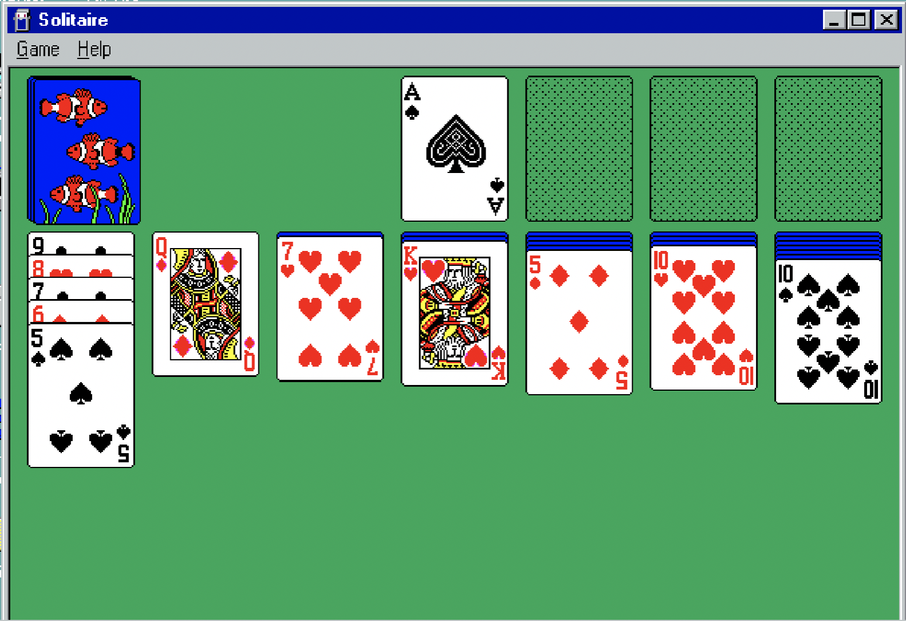

I thought it was fun playing around with the old screensavers and wallpapers. Remember pipes?

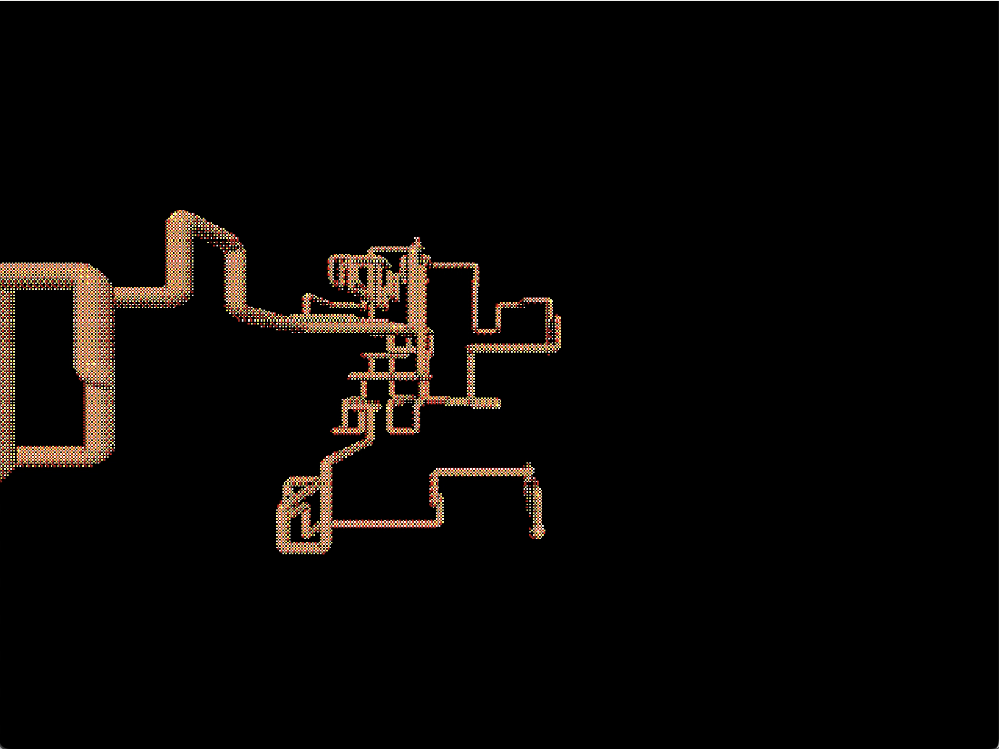

I then had a nostalgic walk through my childhood at my nana's house, playing Freddi the Fish on her old computer in the dining room.

Booting up Freddi Fish 2:

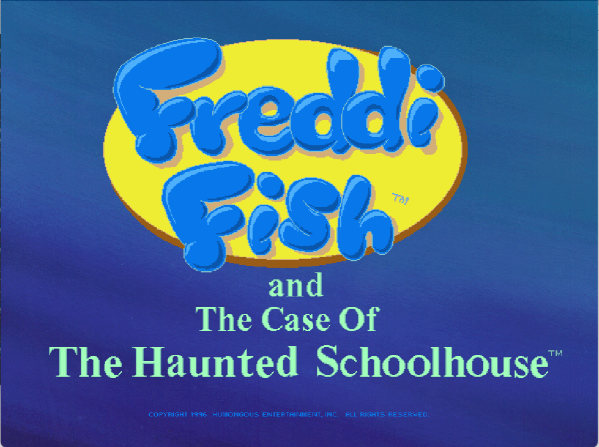

Had to get a quick playthrough:

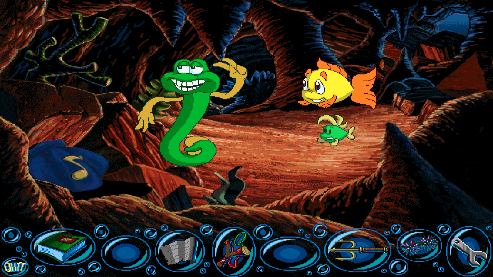

So yeah, that wraps things up. One thing I appreciate about QEMU is it really feels like you're running the actual computer. You click on the CD you want to run and it boots up the installer. It's low level enough that you feel like you're learning stuff vs VirtualBox where everything is set up for you. And apparently, QEMU is way faster than VBox if you enable the KVM hypervisor (doesn't really apply if you're emulating older machines).

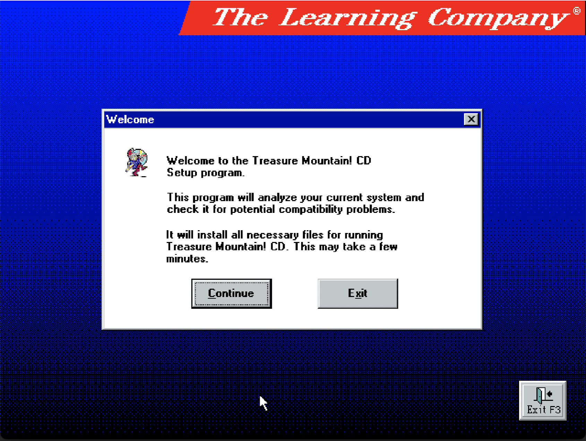

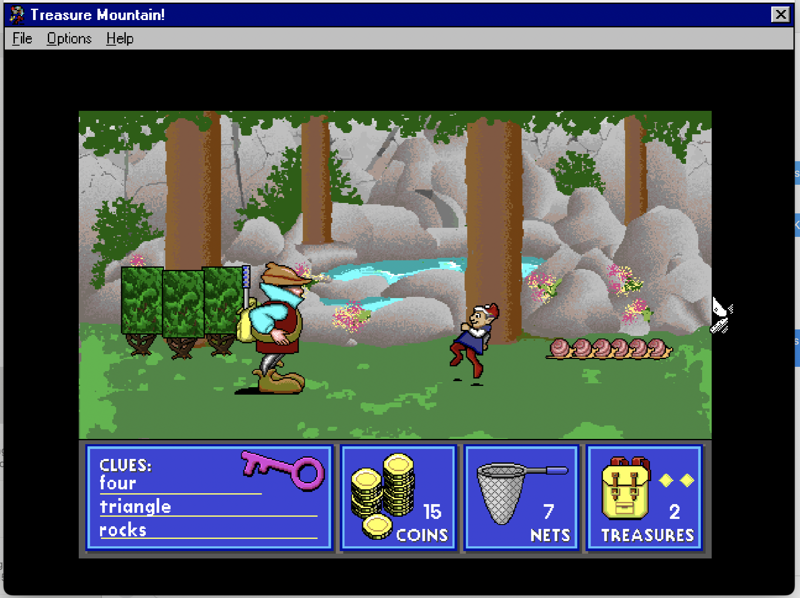

### Lessons Learned

I learned that a lot of stuff is installed after the fact through the Windows 95 installation disk. The first time I did this, I booted into Windows 95 for the first time with the disk removed, and it gave me quite a headache. It didn't install Internet Explorer 4.0 and was stuck on IE 3.0, which actually predates HTTP! So I had to manually install a later version of IE to run any websites. Additionally, the drivers weren't correctly installed, so I had to manually install both the audio driver and the VGA graphics driver.

The installation media for Treasure Mountain came in a .bin and .cue files. Apparently these are richer ways of representing disk media. The .cue file is basically an index file that can store tracks and metadata and such. Unfortunately, I don't think QEMU accepts this so I just asked Claude to convert it to a .ISO file, which worked.
