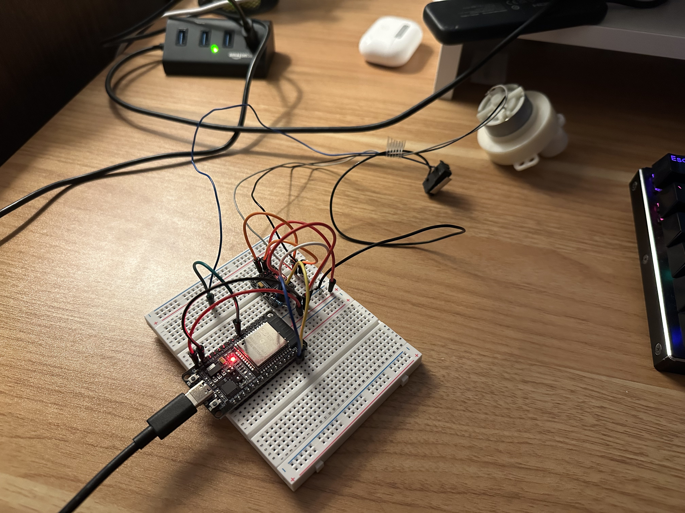
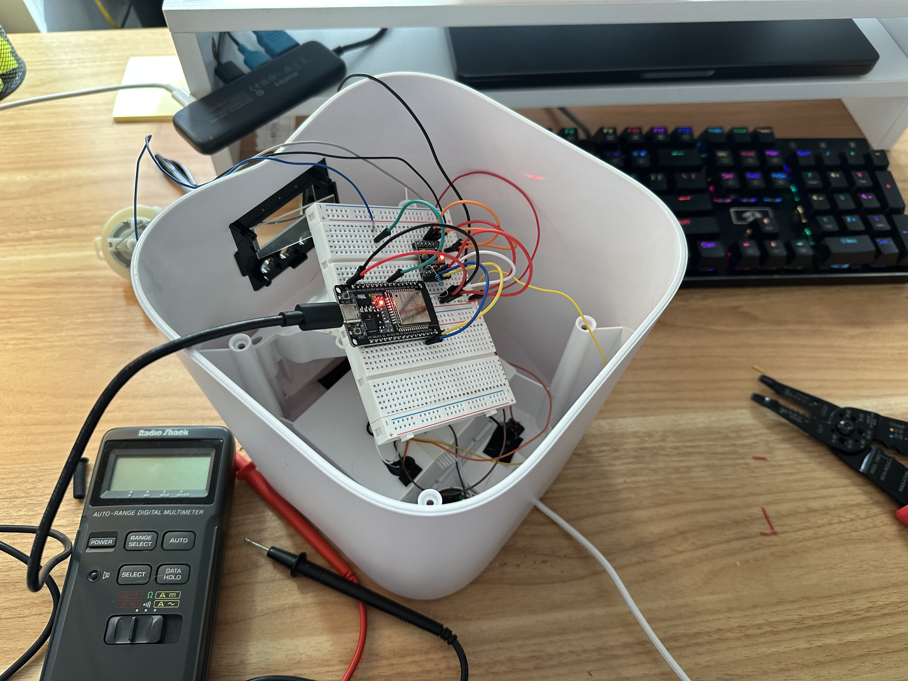

After the first attempt of fixing my cat feeder, I decided to switch from STM32 to ESP32. It felt more intuitive, I liked using PlatformIO, the board was way smaller, and it had WiFi, which I would need for the time sync and command/control.

So, I rewired it to fit niceley on a breadboard, then I ported all the STM32 code to ESP32-Arduino code.

At this point, I had wired everything up and gotten the motor and portion control working, so I was done with hardware. It was time to design the software for this cat feeder. So like any new software, we needed a design plan. I came up with a short list of capabilities I wanted.

**Capabilities**
* control motor and divy out portions
* operate on a daily schedule
* store schedule in case of power failure
* function properly with no Internet
* command and control for modifying portions, times, viewing status information
* over the air updates

**What I was NOT optimizing for:**
* ability to store infinite meals (max 10)
* efficiency with meal storage -> small meal count means we are still fast
* multiple clients

With these considerations, I was ready to build.

## Control Motor/Portion Control

I completed this functionality in Part 1. When triggered, the motor will rotate until the portion button is clicked *count* times, representing the number of desired portions in a meal. It uses a time threshold to detect when the button is pressed, versus just a blip in the sensor, known as debouncing.

## Scheduling

The primary reason for replacing my cat feeder was to have accurate time, so this part was crucial. Originally, I was thinking of syncing it with my laptop, but with Internet access, I decided it was easiest to sync with a NTP server. I do this once when the feeder gets connected to WiFi and then again every hour to avoid drift. 

Note: I used [SNTP](https://timetoolsltd.com/ntp/sntp-overview/) instead of NTP as it is more suited for microcontrollers, using less memory and computing power.

The feeder keeps a flag isSynced that is checked before performing any action - no feeds when unsynced.

## Command and Control

I needed some way to operate the device- adding/deleting meals and changing portion sizes. For this I used the Arduino-ESP32 WebServer library, which creates a server that handles connections in the main loop. I added several commands:

* **getMeals**: returns a table of all meals with index
* **addMeal \<time> \<portions>**: adds a new meal
* **modifyMeal \<time> \<newPortions>**: changes the meal at that time
* **deleteMeal \<time>**: remove the meal occurring at that time
* **dispense \<count>**: dispense "count" portions right now

## Logging

Logging is done via UDP send and forget. Client requests are logged as well as schedule changes and meals fed. I set up a daemon on my Mac that will read these logs and write them to a file daily. 

## Error Handling

As this feeder supplies a crucial part of Sabrina's diet (dry food- maybe next I will build a wet food feeder 😊), it should not break due to environmental reasons like power reset or Internet connection loss. It has no RTC battery, and state is cleared on power loss. This would need to be solved for me to rely on it.

#### Power Loss
I solved the power loss problem by storing meals to static memory. This is implemented by Arduino-ESP32 [Preferences](https://docs.espressif.com/projects/arduino-esp32/en/latest/tutorials/preferences.html) which stores data in a portion of the systems non-volatile memory (NVS) that survives power resets. This is meant to be for small pieces of state that need to survive resets, not large amounts of data. Luckily, the meal list is small. I store the meals as Json objects, parsed and loaded into application state on startup. Anytime they are modified, the new state is persisted to NVS. 

I also ran into issues when there was power loss spanning a feed time. When the schedule comes back up, it could skip meals that should have been provided. To fix this, I saved the last fed day in NVS and check it when loading the schedule. If it’s less than today, the feeder dispenses that portion and sets the last fed day to today. Worst case, it dispenses all portions for a day.

#### Internet Loss
As for Internet loss, the only reason we are using Internet is for time sync and command/control. Once we have the first time sync, isSynced = true for the duration of the program. We still refresh every hour, but never set isSynced to false- we would rather have a functioning feeder that’s out of sync than a broken feeder due to network loss. 

However, that means that in the case of power loss, we will no longer be synced and must wait for an Internet connection to tell us the current time. That is unacceptable.

To fix this, I developed a strategy for "guessing" the time. I save the current time in NVS, so that guessed meals are off by only the amount of time the power is out. Once the NTP server has been unreachable for 50 minutes, I start guessing the time and firing meals on that schedule, marking them with a special flag. Once the NTP time is restored, I adjust any meals fired during that period according to the time differences between guessed and real time.

## Testing

To test this application and error conditions I had to simulate network failures and power failures, and connect to the client for command and control. I wrote a Python client that would interact with the application and tail-ed the logs for debugging outputs. For network faults, I connected to my phone hotspot and switched it off at various points of the schedule. This helped me iterate and discover new problems with state recovery and failure handling. This combined with unplugging it from power occasionally helped me test all combined scenarios of network + power loss. I also tested that all commands worked and produced reasonable outputs. 

All my testing was done on the raw components that were not yet wired in to the full cat feeder box. While this let me easily flash the ESP32,  I knew that once installed, it would be difficult to connect the USB. Luckily, Arduino provides an OTA update library, which was pretty seamless to integrate and allowed me to test even after wiring it into the enclosure.

## Arduino Library Functions

Arduino library has a lot of handy features and they are easy to get set up. I installed:
* Wifi -> TCP connections with clients
* WifiUDP -> UDP streaming of logs
* OTA -> Over the air updates
* ArduinoJson -> JSON support for saving meals

## Putting it all together

With everything tested locally and verified with the hardware wired together on my desk, it was time to install it inside the cat feeder enclosure and verify it dispenses food. Power was supplied by the AC adapter that came with the original cat feeder, and although I had a bit of an issue figuring out which wires were power and ground (they weren’t the standard red and black), I was able to test it using a volt meter and get it installed.

I stuck it nicely to the side, screwed in the enclosure lid, filled it with cat food, and used the Python client to send a dispense request.

[Demo](https://drive.google.com/file/d/14-10JJNEBwXc44oD1TbX4rjJMkxR60fe/view?usp=sharing)
